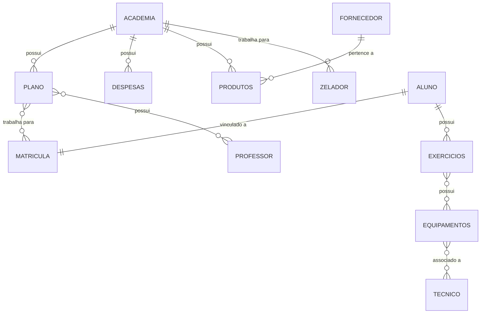

# projeto-academia-bd
<div align="center">

# 🏋️ Academia de Musculação

### Projeto de Banco de Dados


</div>

---

## 📖 Sobre o projeto

Banco de dados relacional para o gerenciamento de uma **academia de musculação**.

O sistema controla:

- 🧑 **Alunos** e suas **matrículas**, com status da mensalidade e frequência
- 📋 **Planos** oferecidos pela academia
- 👨‍🏫 **Professores** e seus horários de trabalho
- 💪 **Exercícios** de cada aluno e os **equipamentos** usados neles
- 🔧 **Técnicos** responsáveis pela manutenção dos equipamentos
- 🛒 **Produtos** vendidos e seus **fornecedores**
- 💰 **Despesas** da academia
- 🧹 **Zeladores**

Projeto da disciplina de **Banco de Dados**, do Departamento de Ciência da Computação da **Universidade de Brasília (UnB)**.

## 👥 Grupo

| Integrante | Responsabilidade |
|---|---|
| **Arthur** | Modelagem (MER e Modelo Relacional) |
| **Sara** | Documentação, GitHub e apresentação |
| **Luiz** | Banco de dados (script SQL) |
| **Thomas** | Testes e programação |

## 🗂️ Conteúdo do repositório

| Arquivo | Descrição |
|---|---|
| 📄 `academia.sql` | Script que cria o banco `academia_db` (tabelas, chaves e restrições) e insere dados de exemplo |

## 🧩 Modelo de dados

O modelo tem **12 entidades**: Academia, Fornecedor, Produtos, Zelador, Despesas, Plano, Professor, Aluno, Matrícula, Exercícios, Equipamentos e Técnico.

Os atributos multivalorados (telefone e e-mail) e os relacionamentos N:N viraram tabelas próprias. Com isso, o script cria **22 tabelas**.

### Relacionamentos principais



### Restrições usadas

- 🔑 **Chaves primárias**, inclusive automáticas (`AUTO_INCREMENT`) em várias tabelas
- 🔗 **Chaves estrangeiras**, com `ON DELETE CASCADE` nas tabelas associativas
- ⛔ **NOT NULL** nos campos obrigatórios
- ☝️ **UNIQUE** em e-mails e na matrícula de cada aluno
- ✅ **CHECK** para valores válidos (preços maiores que zero, status permitidos, turnos etc.)

## 🚀 Como executar

**Requisitos:**
- MySQL **8.0.16 ou superior** (versões anteriores ignoram as restrições `CHECK`)
- MySQL Workbench

**Passo a passo:**

1. Abra o MySQL Workbench e conecte-se ao servidor.
2. Abra o arquivo `academia.sql` em **File → Open SQL Script**.
3. Clique no raio ⚡ para executar o script inteiro.
4. Atualize a lista de schemas. O banco `academia_db` deve aparecer com 22 tabelas.

> ⚠️ O script apaga e recria o `academia_db` sempre que é executado.

## 🔍 Exemplo de consulta

Alunos com o plano e o status da mensalidade:

```sql
USE academia_db;

SELECT a.nome, p.nome_plano, m.status_mensalidade
FROM Aluno a
JOIN Matricula m ON m.cpf_aluno = a.cpf
JOIN Plano_Matricula pm ON pm.id_matricula = m.id_matricula
JOIN Plano p ON p.id_plano = pm.id_plano;
```

## 📌 Andamento

**Entrega 1 (17/11)**
- [x] Script SQL com tabelas, chaves e restrições
- [x] Dados de exemplo (10 ou mais registros nas principais tabelas)
- [ ] Introdução, MER e Modelo Relacional em PDF

**Entrega final (01/12 e 03/12)**
- [ ] View
- [ ] Procedure
- [ ] Trigger
- [ ] Campo binário (foto ou PDF)
- [ ] Aplicação com interface gráfica e CRUD
- [ ] Diagrama da camada de mapeamento

---

<div align="center">

Feito com 💪 pelo grupo • UnB • 2026

</div>
